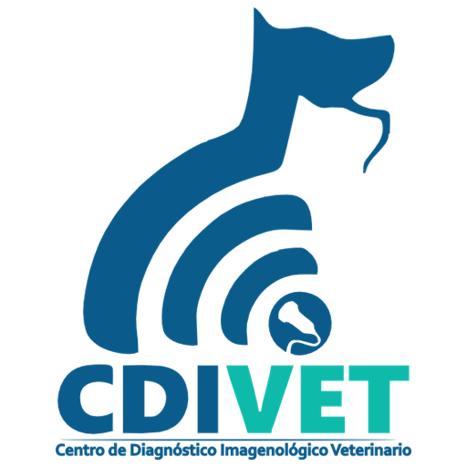

# CDIVET DICOM Viewer

Visor DICOM **gratuito** para **Windows y Mac** pensado para veterinaria: radiografía, ecografía, TC y RM.

## ⬇️ Descargar

**[Descargar la última versión](../../releases/latest)** → en "Assets", elige el archivo de tu equipo:

| Tu equipo | Archivo |
| --- | --- |
| Windows 10 u 11 (64 bits) | `CDIVET-DICOM-Viewer-Setup-….exe` |
| Mac con chip Apple (M1, M2, M3, M4…) | `CDIVET-DICOM-Viewer-…-arm64.dmg` |
| Mac con procesador Intel | `CDIVET-DICOM-Viewer-…-x64.dmg` |

¿No sabes qué chip tiene tu Mac? Menú  → **Acerca de este Mac**: en "Chip" o "Procesador" verás "Apple M…" o "Intel".

> ⚠️ La versión de Mac es **de prueba**: pasa una prueba automática, pero todavía no se ha usado en un Mac real.

## Qué hace

- Abre estudios desde una carpeta, un ZIP o archivos DICOM sueltos (también arrastrándolos).
- Visor 2D con cine (cineloops de ecografía), varios visores, ventana/nivel con ajustes rápidos, medidas (regla, ángulo, ROI en HU), flechas y texto.
- MPR con planos oblicuos, MIP de grosor ajustable, cine y orientación veterinaria.
- 3D con ajustes rápidos (hueso, tejido blando, pulmón, vasos, piel), MIP y vistas rápidas.
- Grabación de vídeo MP4 en 2D, MPR y 3D, con opción de ocultar los datos del paciente.
- Modo claro y modo oscuro.

## Instalar en Windows

1. Descarga el instalador `.exe` desde [Releases](../../releases/latest).
2. Ábrelo. Si Windows muestra **"Windows protegió su PC"**, pulsa **Más información → Ejecutar de todas formas**. Aparece porque el programa no está firmado digitalmente.
3. No necesita permisos de administrador. Crea accesos directos en el Escritorio y en el menú Inicio.

## Instalar en Mac

1. Descarga el `.dmg` de tu chip desde [Releases](../../releases/latest), ábrelo y **arrastra CDIVET DICOM Viewer a la carpeta Aplicaciones**.
2. Abre la app desde Aplicaciones. La primera vez, macOS la bloqueará porque no está firmada por Apple.
3. Ve a **Ajustes del Sistema → Privacidad y seguridad**, baja hasta el aviso de CDIVET y pulsa **"Abrir igualmente"**. En macOS 13 y 14 también sirve **clic derecho sobre la app → Abrir**.
4. A partir de ahí se abre con normalidad. Para grabar vídeo puedes usar **Cmd+Mayús+R** (además de F8).

**Requisitos:** Windows 10 u 11 de 64 bits, o macOS 13 o posterior. Para MPR y 3D se recomiendan 8 GB de RAM o más.

## Privacidad

CDIVET DICOM Viewer **no se conecta a internet**. Las imágenes y los datos de los pacientes nunca salen de tu ordenador.

## ⚠️ Aviso importante

Es una herramienta de **consulta y docencia**. **No es un producto sanitario certificado** y no debe usarse para diagnóstico.

## Créditos

Autor: **Ernesto Weber Rodríguez** · CDIVET, Centro de Diagnóstico Imagenológico Veterinario.

Creado con [ClonaKit](https://www.divisualproject.academy). Usa librerías de código abierto (Electron, Cornerstone3D, vtk.js y otras); sus licencias están en [LICENCIAS-TERCEROS.txt](LICENCIAS-TERCEROS.txt). El logo de CDIVET pertenece a su autor.
